<!--
SPDX-FileCopyrightText: Copyright (c) 2026 Josh Symonds
SPDX-License-Identifier: Apache-2.0
-->

# ffr-unstraightened

A text-only dialogue mod for FINAL FANTASY RESONANCE (Steam app 3259780, Unreal Engine).
It changes the game's English string table and nothing else. The `ffrd` command
line tool pulls the game's text, checks your edits against it, and packs them into
mod files the game loads.

## Why it exists

The game's text lives in `FFRS/Content/Localization/Game/<lang>/Game.locres` inside
the game's paks. Editing a line by hand breaks silently when the game changes that
line. Each edit here is keyed by namespace and key, and stores a hash of the line it
replaces. A build fails when that line changes in the game, so an update never
reverts an edit without warning.

## How it fits together

The colours show where each step runs. Yellow boxes are commands in this
repository. Blue is your `dialog/` edits. Grey is the game's files. Green is local
data that git ignores.

```mermaid
flowchart LR
    paks["Game paks<br/>FFRS-Windows*.pak"]:::game
    extract["ffrd extract"]:::repo
    progress["ffrd progress"]:::repo
    vanilla["vanilla/<br/>English and Japanese text"]:::local
    find["ffrd find<br/>up to recorded chapter"]:::repo
    edits["dialog/**/*.toml"]:::mine
    build["ffrd build"]:::repo
    out["build/FFRS-Unstraightened_P<br/>.pak .utoc .ucas"]:::local
    install["ffrd install"]:::repo
    mods["Paks/~mods"]:::game
    leak["ffrd leak-check"]:::repo

    paks --> extract --> vanilla
    progress --> find
    vanilla --> find --> edits
    edits --> build
    vanilla --> build --> out --> install --> mods
    vanilla --> leak

    subgraph key["Key"]
        direction LR
        k1["This repo's commands"]:::repo ~~~ k2["Your dialog/ edits"]:::mine ~~~ k3["The game's files"]:::game ~~~ k4["Gitignored local data"]:::local
    end

    classDef repo fill:#fde68a,stroke:#b45309,color:#1f2937
    classDef mine fill:#bfdbfe,stroke:#1d4ed8,color:#1f2937
    classDef game fill:#e5e7eb,stroke:#4b5563,color:#1f2937
    classDef local fill:#bbf7d0,stroke:#15803d,color:#1f2937
```

`ffrd extract` copies the game's text into `vanilla/`. `ffrd find` prints entries from
`vanilla/` as TOML stubs for you to edit. `ffrd build` checks `dialog/` against
`vanilla/` and writes the mod files to `build/`. `ffrd install` copies them into the
game. `ffrd leak-check` checks the git history for game text.

## Install

You need Nix with devenv, and the game installed through Steam.

Run `direnv allow` to load the devenv environment through `.envrc`, or run `devenv shell`.
devenv provides repak with Epic's Oodle runtime, Python with pylocres, ruff,
basedpyright, just, mermaid-cli, and the `ffrd` script. `ffrd` always runs from the
repository root.

## Use

Set the game's Text Language to English before you play.

| Command | What it does |
| --- | --- |
| `ffrd extract` | Unpacks the English and Japanese `Game.locres` from the installed game's paks into `vanilla/`, later patch paks winning. Writes `vanilla/BUILDID` and a reference `vanilla/en.po`. Run it after install and after every game update. |
| `ffrd progress <chapter>` | Records the chapter you are on. `ffrd progress` with no argument prints the recorded chapter. |
| `ffrd find [pattern] [-n NS]` | Prints vanilla entries as TOML stubs for `dialog/`. `pattern` is a case-insensitive regex matched against text or key. `-n` is a regex the namespace must match. Requires recorded progress. Prints `# N shown, M withheld` to stderr. |
| `ffrd build [--full]` | Checks every `dialog/**/*.toml` edit against the game's text, then writes the mod files to `build/`. `--full` packs the whole English table with the edits applied. |
| `ffrd install [--deck]` | Copies the three mod files into `<game>/FFRS/Content/Paks/~mods`. `--deck` copies them to a Steam Deck over `ssh`. |
| `ffrd uninstall [--deck]` | Removes the mod files from `Paks/~mods`. `--deck` removes them from a Steam Deck over `ssh`. |
| `ffrd leak-check` | Scans every commit reachable from HEAD for vanilla strings of 20 or more characters, in paths, file contents and messages. Prints `0` when clean. Otherwise prints a location and table key for each match, never the text, and exits 1. |
| `ffrd report --lens <name>` | Counts the outcomes in `work/<name>/outcomes.jsonl` per chapter: changed, kept for plot, gate failed, unfinished and untouched. Also counts changed lines per lens reason id and per numbered character, and gate failures per gate. Characters are numbers, never names. Lines without a chapter count under `unattributed`. Never prints line text. |
| `ffrd diff --lens <name>` | Shows each rewrite in `dialog/<name>/` beside its vanilla English line, for chapters at or below the recorded chapter. Lines from later chapters and lines without a chapter are hidden. Requires recorded progress. Prints `# N shown, M withheld, K without a chapter` to stderr. |
| `ffrd tune --lens <name>` | Sets the Jev triage threshold for `lenses/<name>.toml`. Samples up to 100 in-scope scenes, has the Sonnet screen label each one, and scores each one with Jev. The threshold is the lowest Jev score among the scenes the screen flagged, so no flagged sample falls below it. Saves `work/<name>/threshold.json` and prints the threshold and counts. Fails until the pipeline is bound. |
| `ffrd run --lens <name> [--no-triage]` | Rewrites the in-scope lines of the lens's scenes, then writes each line's outcome to `work/<name>/outcomes.jsonl` and each changed line to `dialog/<name>/`. Triages with the threshold from `ffrd tune`, or screens every scene with `--no-triage`. Fails until the pipeline is bound. See [Rewrite pipeline](#rewrite-pipeline). |

Edits go in any `dialog/**/*.toml` file. Each edit is one table, keyed by namespace
and key, with `vanilla` (the hash of the current English line) and `text` (your
replacement). The format and the rules `ffrd build` enforces are in
[dialog/README.md](dialog/README.md). A stub from `ffrd find` starts with `text` set
to the game's line; `ffrd build` rejects it until you change `text`.

Each `ffrd build` writes `build/FFRS-Unstraightened_P.pak`, `.utoc` and `.ucas`.
The `.utoc` and `.ucas` files are copies of the game's empty `global` container,
which the loader requires.

The default build writes `en/Unstraightened.locres`, which holds only the edited
entries. See [Limits](#limits).

`ffrd find` only shows lines from chapters at or below the chapter you recorded.
Namespaces that name no chapter are never shown. A namespace names a chapter when it
has `ST_C<n>_` at the start or a later `C<n>` underscore segment.

To recover a Steam Deck install that breaks the game, run `ffrd uninstall --deck`.

### Rewrite pipeline

`ffrd tune --lens <name>` and `ffrd run --lens <name>` change only in-scope lines:
main story dialogue (`ST_C<n>_`), side-event dialogue (`ST_SubEv_`), and the
`ST_DialogChoice`, `ST_MainSummary` and `ST_UnitDescription` namespaces, bare or
followed by `_`. Names, menus, items, skills and tutorials never change.

`ffrd run` works through the lens's scenes in order. It writes a story bible for each
chapter and triages each scene with Jev against the stored threshold, unless
`--no-triage` is given. The Sonnet screen
flags the lines to change. For each flagged line, Opus writes an intent and a draft, the
voice is rendered, and the gates run: placeholders, tags, length within 120% of vanilla
with the same line breaks, the classifier, a scene judge, and a cross-scene judge for
lines a callback touches. The best passing candidate is kept. A line with no passing
candidate stays vanilla. Each changed line goes to `dialog/<name>/chapter-NN.toml`, or
to `dialog/<name>/unattributed.toml` when it names no chapter. Each table records the
vanilla hash, the text, the lens, the reason, the writer, the verdict and the run.

Progress prints scene keys and counts only. Every model result is saved under
`work/<name>/` as it arrives, so a rerun resumes where it stopped. Claude calls run
through `cswap`, which picks the least-used account. Jev triage needs `TYPESAFE_API_KEY`.

### Environment variables

| Variable | Default | Purpose |
| --- | --- | --- |
| `FFR_GAME` | `~/.local/share/Steam/steamapps/common/FINAL FANTASY RESONANCE` | The installed game. |
| `FFR_VANILLA` | `<repo>/vanilla` | Where extracted vanilla text is read from and written to. |
| `FFR_PROGRESS` | `$XDG_STATE_HOME/ffrd/progress`, else `~/.local/state/ffrd/progress` | The file holding the recorded chapter. |
| `FFR_DECK_HOST` | `deck` | The `ssh` host for `--deck`. |
| `FFR_DECK_PAKS` | `~/.local/share/Steam/steamapps/common/FINAL FANTASY RESONANCE/FFRS/Content/Paks` | The Steam Deck's game Paks folder for `--deck`. |
| `TYPESAFE_API_KEY` | none | The Jev API key. `ffrd tune` requires it, and so does `ffrd run` without `--no-triage`. |
| `TYPESAFE_BASE_URL` | `https://api.typesafe.ai` | The Jev endpoint. |
| `TYPESAFE_MODEL` | `jev-latest` | The Jev model. |

## Limits

- **`ffrd tune` and `ffrd run` fail until the pipeline is bound.** Both need a scene
  source, a classifier and a renderer. None is bound yet, so neither can run.
- **The default build is partial, and its loading is unproven.** `ffrd build` writes
  `en/Unstraightened.locres`, which holds only the edited entries. It relies on the
  game honouring a second `en/*.locres` over `Game.locres`. That behaviour is not
  confirmed. If the game ignores the partial table, use `ffrd build --full`. It packs
  the whole English table with the edits applied, and it replaces the game's table.
- **Game updates block builds.** `ffrd build` refuses to run when the game has
  updated since `ffrd extract`. The error says to run `ffrd extract` and rebuild.
- **Edits fail on changed lines.** An edit whose `vanilla` hash no longer matches the
  game's current line fails the build with "changed in the game".
- **`ffrd leak-check` skips short strings.** It ignores vanilla strings shorter than
  20 characters, so a short match is not reported.
- **Text only.** The mod changes the English string table. It does not change
  assets, and it does not change Japanese text.

## Development

- `just check` runs ruff lint and format checks, basedpyright, and pytest.
- `just fmt` formats and fixes with ruff.
- `just docs` renders every Mermaid block in tracked Markdown to SVG under `build/docs/`.
- `just check-provenance` fails when the history names withheld private terms. It
  prints locations and digest prefixes, never the matched text.

Tests use synthetic fixtures only. See `tests/conftest.py`. Coding agents follow
[AGENTS.md](AGENTS.md).

`vanilla/`, `work/` and `build/` are gitignored.

## License

The code is licensed under the Apache License 2.0. See [LICENSE](LICENSE).

FINAL FANTASY RESONANCE and its text belong to Square Enix. The edits in `dialog/`
derive from Square Enix's text. This repository claims no license over them.
