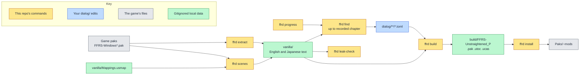

<!--
SPDX-FileCopyrightText: Copyright (c) 2026 Josh Symonds
SPDX-License-Identifier: Apache-2.0
-->

# ffr-unstraightened

A text-only dialogue mod for FINAL FANTASY RESONANCE (Steam app 3259780, Unreal Engine).
It changes the game's English text. The default pak also carries an
`FFRS/Config/UserGame.ini` that adds its own localization folder. The `ffrd` command
line tool pulls the game's text, checks your edits against it, and packs them into
mod files the game loads.

## Why it exists

The game's text lives in `FFRS/Content/Localization/Game/<lang>/Game.locres` inside
the game's paks. Editing a line by hand breaks silently when the game changes that
line. Each edit here is keyed by namespace and key, and stores a hash of the line it
replaces. A build fails when that line changes in the game, so an update never
reverts an edit without warning.

## How it fits together

The colours show where each step runs. Yellow boxes are commands in this
repository. Blue is your `dialog/` edits. Grey is the game's files. Green is local
data that git ignores.



`ffrd extract` copies the game's text into `vanilla/`. `ffrd find` prints entries from
`vanilla/` as TOML stubs for you to edit. `ffrd build` checks `dialog/` against
`vanilla/` and writes the mod files to `build/`. `ffrd install` copies them into the
game. `ffrd leak-check` checks the git history for game text. `ffrd scenes` writes
`vanilla/scenes.json`, which lists the story lines with their speakers and voice cues.

## Install

You need Nix with devenv, and the game installed through Steam.

Run `direnv allow` to load the devenv environment through `.envrc`, or run `devenv shell`.
devenv provides repak with Epic's Oodle runtime, the .NET 10 SDK, Python with pylocres, ruff,
basedpyright, just, mermaid-cli, and the `ffrd` script. `ffrd` always runs from the
repository root.

## Use

Set the game's Text Language to English before you play.

| Command | What it does |
| --- | --- |
| `ffrd extract` | Unpacks the English and Japanese `Game.locres` from the installed game's paks into `vanilla/`, later patch paks winning. Writes `vanilla/BUILDID` and a reference `vanilla/en.po`. Run it after install and after every game update. |
| `ffrd progress <chapter>` | Records the chapter you are on. `ffrd progress` with no argument prints the recorded chapter. |
| `ffrd find [pattern] [-n NS]` | Prints vanilla entries as TOML stubs for `dialog/`. `pattern` is a case-insensitive regex matched against text or key. `-n` is a regex the namespace must match. Requires recorded progress. Prints `# N shown, M withheld` to stderr. |
| `ffrd build [--full \| --partial \| --ue4ss]` | Checks every `dialog/**/*.toml` edit against the game's text, then writes the mod to `build/`. The default shape packs the edited entries and a `UserGame.ini` that puts them ahead of the game's table. See [Build shapes](#build-shapes). |
| `ffrd install [--deck]` | Copies `build/FFRS-Unstraightened_P.pak`, `.utoc` and `.ucas` into `<game>/FFRS/Content/Paks/~mods`, whichever pak shape the last build wrote. It does not copy the `--ue4ss` folder. `--deck` copies them to a Steam Deck over `ssh`. |
| `ffrd uninstall [--deck]` | Removes the mod files from `Paks/~mods`. `--deck` removes them from a Steam Deck over `ssh`. |
| `ffrd leak-check` | Scans every commit reachable from HEAD for vanilla strings of 20 or more characters, in paths, file contents and messages. Prints `0` when clean. Otherwise prints a location and table key for each match, never the text, and exits 1. |
| `ffrd report --lens <name>` | Counts the outcomes in `work/<name>/outcomes.jsonl` per chapter: changed, kept for plot, gate failed, unfinished and untouched. Also counts changed lines per lens reason id and per numbered character, gate failures per gate, and lines the intent stage kept per keep reason (`kept <reason>: n`). When `work/<name>/scenes.jsonl` exists, each block also counts the scene pass: eligible scenes, scenes flagged per pattern, plans, scenes kept per scene keep reason, planned lines (and how many were required), changed, replanned and reverted lines, scene-pass gate failures per gate, the most and the median changed lines per planned scene, and scene-pass changed lines per numbered character. Characters are numbers, never names. Lines without a chapter count under `unattributed`. After the blocks it prints `scenes: C of T from the scene table, F outside it`: `T` is the scenes in `vanilla/scenes.json`, `C` those holding at least one outcome line, and `F` the namespaces of outcome lines the table lacks; it fails when the scene table is missing. Then it prints `arcs: N, M with changes` from `work/<name>/arcs.json`, then `redo: n listed, m changed, k gate failed`: the lines on the redo list (those with `redo` true in `outcomes.jsonl`), how many of them changed and how many failed a gate, whatever the gate. For a lens with `selection = "queering"`, it then prints the queering counts: `queering romance: L lines, C characters, S speakerless`, `queering gender roles: L lines, C characters`, `queering eligible characters: E`, `queering candidates: insertable L lines, C characters; trans-candidate L lines, C characters; U scenes unfinished`, then for the romance, world, nonbinary and trans sides in that order, `queering <side> target: T (S% of D, pool P)`, where `S` is the side's share, `D` its denominator and `P` its pool, one `queering <side> round n: tried T, passed P` line per refill round, and `queering <side> achieved: A of T`, with `, pool exhausted` added when `A` is below `T`. Then `queering flirt marked: N, redirect half: M`, `queering changed queer|world|nonbinary|trans|redirect: N` and `queering gate failed queer|world|nonbinary|trans|redirect: N`, where `queer` is the romance side's bucket. Then it prints one `recall <id>: N disagreements, M confirmed` line per triage id from `recall.json`. When `work/<name>/usage.jsonl` holds an entry, it then prints a `usage run <id>` block for the latest run id, with calls, input, output, cache read and cache write tokens, prompt tokens per call (input plus cache read plus cache write, divided by calls, rounded) and cost in dollars per stage and model, then a total. Never prints line text. |
| `ffrd diff --lens <name>` | Shows each rewrite in `dialog/<name>/` beside its vanilla English line, for chapters at or below the recorded chapter. Lines from later chapters and lines without a chapter are hidden. Requires recorded progress. Prints `# N shown, M withheld, K without a chapter` to stderr. |
| `ffrd run --lens <name> [--no-jev] [--concurrency N] [--account N] [--through N]` | Rewrites the in-scope lines of the lens's scenes. Screens every scene and runs the Jev recall check unless `--no-jev` skips it. A lens with `selection = "queering"` runs the queering selection instead: a screen, a Haiku candidate pass and the four refill sides, with no Jev. Keeps up to `N` Claude calls in flight at once, 8 by default. `--account N` pins every Claude call of the run to cswap account `N`, skipping the 90% weekly filter for it, and a rate limit makes the run wait for that account's earliest reset and retry it, refusing before any Claude call unless `N` is a usable account. `--through N` keeps only the lines in chapters at or below `N`. Checks `ledger/<name>.jsonl` before any Claude call and appends to it at the end. Holds an exclusive lock on `work/<name>/.run.lock` for the whole run, so a second `ffrd run` of the same lens stops with an error before any Claude call. Writes `work/<name>/outcomes.jsonl`, `arcs.json` and `recall.json`, and each changed line to `dialog/<name>/`. A queering run also writes `work/<name>/marks.jsonl` and `selection.json`. Each model call appends one entry to `work/<name>/usage.jsonl`; stored results append none. See [Rewrite pipeline](#rewrite-pipeline). |
| `ffrd smoke [--scene <key>]` | Runs one in-scope scene through every stage of `ffrd run` with live models, writing only under `work/smoke/`. Prints a count per stage and exits 1 when a stage produced no result. See [Smoke run](#smoke-run). |
| `ffrd probe [--shape {target,full,partial,ue4ss}]` | Installs the built mod with a probe-only marker pak beside it on the probe host, and passes when the game honours the marker. Removes both afterwards. `--shape` probes one shape alone. Prints only keys and hashes. See [Probe host](#probe-host). |
| `ffrd usmap` | Dumps the game's mappings on the probe host to `vanilla/Mappings.usmap`. Re-run it after each game update. See [Probe host](#probe-host). |
| `ffrd shot <namespace> <key> [--vanilla]`, `ffrd shot --title [--vanilla]` | Brings a changed line on screen in the game on the probe host and saves a PNG of the game window to `shots/`, after the mod or, with `--vanilla`, before it. Keeps the PNG only when the line's hash matches before and after the capture. Runs inside the save guard. Prints only keys and hashes. See [Screenshots](#screenshots). |
| `ffrd scenes [--check]` | Runs the C# extractor in `tools/scenes/` through `dotnet run` and writes `vanilla/scenes.json`. Needs `ffrd extract` and `ffrd usmap` for the same game build. Prints counts only. `--check` prints the counts and the attributed percentage, and exits 1 when the table is missing, built for another game build, or under 95% attributed. See [Scene data](#scene-data). |
| `ffrd voice pairs [--check] [--limit N]` | Writes four paraphrases per story line to `work/voice/train.jsonl`, `heldout.jsonl` and `calls.jsonl`: two from Opus, one from Sonnet and one from Haiku. Makes eight calls at a time, spread across the configured Claude accounts. A tenth of the scenes are held out. A rerun resumes from saved results. `--limit N` paraphrases only the first N scenes. `--check` prints the split and the call counts without calling Claude. Prints counts only. See [Voice models](#voice-models). |
| `ffrd voice pilot [--scenes N]` | Runs the first N scenes (default 50) through `pairs` and both trainings. Prints calls, tokens, account usage, steps and seconds per step, and projected totals that include waits for account resets. |
| `ffrd voice classifier train [--epochs N]` | Stages the classifier examples and trains the classifier on the GPU host. `--epochs` sets the passes over the examples (default 1). |
| `ffrd voice lora train [--epochs N]` | Stages the train pairs and finetunes the LoRA adapter on the GPU host. `--epochs` sets the passes over the training records (default 1). |
| `ffrd voice lora export` | Exports the finetuned adapter to GGUF on the GPU host. |
| `ffrd voice serve [--stop] [--port P]` | Starts llama-server on the GPU host's 127.0.0.1, or stops the running one with `--stop`. |
| `ffrd voice render --speaker NAME [--port P]` | Reads one line on stdin and voices it through the GPU host's llama-server, over an ssh tunnel. It is the rewrite pipeline's tool. Do not use it to read lines by hand. |
| `ffrd voice eval classifier`, `ffrd voice eval render`, `ffrd voice eval revert` | Prints voice-model metrics and nothing else. See [Voice models](#voice-models). |

Edits go in any `dialog/**/*.toml` file. Each edit is one table, keyed by namespace
and key, with `vanilla` (the hash of the current English line) and `text` (your
replacement). The format and the rules `ffrd build` enforces are in
[dialog/README.md](dialog/README.md). A stub from `ffrd find` starts with `text` set
to the game's line; `ffrd build` rejects it until you change `text`.

### Build shapes

`ffrd build` has four shapes. The default is `target`. Each pak shape writes
`build/FFRS-Unstraightened_P.pak`, `.utoc` and `.ucas`. The `.utoc` and `.ucas` files
are copies of the game's empty `global` container, which the loader requires.

- `target` (default): the pak holds `FFRS/Content/Localization/Unstraightened/en/Unstraightened.locres`,
  which has only the edited entries, and `FFRS/Config/UserGame.ini`. That ini lists the
  Unstraightened folder ahead of `Game`, so the game reads the edits first.
- `--full`: the pak holds `FFRS/Content/Localization/Game/en/Game.locres`, the whole
  English table with the edits applied. It replaces the game's own table.
- `--partial`: the pak holds `FFRS/Content/Localization/Game/en/Unstraightened.locres`,
  which has only the edited entries. The game was seen to ignore it. It is kept for
  comparison. See [Limits](#limits).
- `--ue4ss`: no pak. `build/UnstraightenedText/` holds `Scripts/main.lua`, an empty
  `enabled.txt` and `edits.txt`. It needs UE4SS on the player's install, and
  `ffrd install` does not copy it. The edits register only in English culture (`en`, `en-*`).

`ffrd find` only shows lines from chapters at or below the chapter you recorded.
Namespaces that name no chapter are never shown. A namespace names a chapter when it
has `ST_C<n>_` at the start or a later `C<n>` underscore segment.

To recover a Steam Deck install that breaks the game, run `ffrd uninstall --deck`.

### Rewrite pipeline

`ffrd run --lens <name>` changes only in-scope lines.
A line is in scope when the scene source yields it from the game's scene table. That
covers event dialogue, including unnumbered side events, which count under the chapter
that unlocks them, and the `ST_DialogChoice`, `ST_MainSummary` and `ST_UnitDescription`
namespaces. The bound source always has a scene table. A source without one, such as a
test fixture, uses a fallback allowlist. It matches the `ST_C<n>_`,
`ST_SubEv`, `ST_ChrEv`, `ST_FEV`, `ST_LegendEV`, `ST_GimEv`, `ST_BtlEv` and `ST_EV`
prefixes, plus the same three namespaces. Hard exclusions apply in every case:
`ST_Tutorial*`, `ST_UI*`, any namespace ending in `Name` or `SkillDescription`, and
`ST_ConsumablesDescription`, `ST_EquipmentDescription` and `ST_ArtifactDescription`.
Names, menus, items, skills and tutorials never change.

The `unstraightening` lens is `lenses/unstraightening.toml`. Its rules, refinements,
protections and precedence are recorded in
[docs/lenses/unstraightening.md](docs/lenses/unstraightening.md).

`ffrd run` works in three stages.

First, for a lens without a `base`, Opus writes a story bible for each chapter, in script order. A bible lists the
characters with their gender and notes, the facts, the callbacks, and the arcs. Each arc
has an id, its characters, its state in that chapter, and beats. A beat sits on a line
and has a kind (setup, escalation, declaration, payoff or other) and an earned flag.
Lines that name no chapter are read after the last chapter, one chunk per namespace, and
those chunks run at the same time. Then a backward pass runs over the chapters in
reverse order. It adds the setups that later bibles rely on to each chapter's callbacks.
Story-bible refs to lines outside the passed lines (fact lines, callbacks and beats) are
dropped, not rejected.

A lens with a `base` makes no bible or setups call of its own. It reads the base lens's
stored bible from `work/<base>/`, under the keys the base run stored. Those keys come from
every in-scope scene with its game English, whatever `--through` says. If a record is missing,
the run fails naming the chapter (`chapter N`, or `unplaced` for lines with no chapter) and
asks for `ffrd run --lens <base>` first. Core cast, antagonists and flirt come from that
bible. `--through` limits only the scenes the run works on.

Second, the scenes run at the same time, each as its own batch. The screen checks
every line of the scene against the screen criteria, with the cast notes from the bibles.
It runs on the lens's screen model, Opus by default. Jev
scores the scene for each triage question. For each triage id that scores 0.5 or more
and that the screen flagged on no line, Opus rechecks the scene for that id, and the
lines it flags join the screen's flags. Opus then writes an intent for each flagged
line, and one draft call writes the drafts for all the flagged lines in the scene. Each
draft is also rendered in the voice. A line with no speaker is not voiced, so its voiced
version is its draft unchanged. Both versions go through the gates in this order:
placeholders, tags, length (within 120% of vanilla, with the same line breaks), the
classifier, and the scene judge. The classifier fails a candidate that scores below 0.5,
the bar the voice evaluation uses. The scene judge checks meaning, plot, minimal change,
callback and fixed. A line without a bucket is judged on these five alone. A queering line
is judged with its bucket and must also pass `no_invention` and `point`, as
`lenses/README.md` describes. A line with callbacks also goes to
the cross-scene judge, which runs only after the scene judge passes. If no candidate
passes, the line gets one more draft, told which gate failed. If that also fails, the
line stays vanilla. It counts as kept for plot when the plot gate failed, and as gate
failed otherwise. Among the passing candidates, the one that restores the Japanese meaning
ranks first, then the one with
the smallest edit distance from the English line. A scene with two or more changed lines
then goes through the coherence check. It reads the scene with its rewrites applied,
against the arcs and the judge rubric.

Within a scene, calls that do not depend on each other also run at the same time. That
covers the screen with Jev, the recheck for each disagreeing triage id, the intents, the
renders of a line's drafts, and the judges of the flagged lines and of their candidates.

When the lens has a `[scene]` section, each scene from the game's scene table then gets a
scene pass, after its line pass. Opus screens the whole scene against the scene
criteria and names each scene pattern it hits, with the lines that carry it. For a scene
with a hit, Opus writes a plan: either it keeps the scene and names one of the lens's
scene keep reasons, or it plans at most four line rewrites, each marked required or
optional and each quoting the words of its line that carry the pattern; a planned line
with no such words is rejected. A plan never touches a line the line pass flagged, whatever that line's
outcome. Each planned line is drafted and rendered like a line-pass line and goes
through the placeholder, tag, length and classifier gates, but not the per-line judge.
An optional line that fails is dropped. This is the carrier gate. After the gates above,
a candidate that still contains the words the plan quoted for its line, ignoring case,
is dropped, since it has not changed the pattern. The candidate nearest the English line
among the rest wins. A line left with no candidate fails the `scene` gate. A required line that fails sends the scene back
for one new plan without that line; if that plan also loses a required line, the scene
stays vanilla. Opus then judges the plan as a whole against the lens's scene rubric, in
the same two-pass way as the coherence check, reading the scene with the line-pass
rewrites that survived coherence applied. The coherence check itself runs before the
scene pass and reads only line-pass rewrites. Each scene-pass rewrite carries its plan
id. The scene judge reverts only the lines it names; when the arc judge reverts one line
of a plan, every line of that plan reverts. The pass writes one record per in-scope scene to
`work/<name>/scenes.jsonl`. No Jev check runs for scene patterns.

A redo list, `lenses/<lens>.redo.toml`, asks for a line to be drafted again. It is
committed and holds only keys and notes, never game text. It has one table per namespace,
with entries `key = "note"`, where the note is a plain-language problem such as
"changes the line's point", "adds a prop not in the line" or "ungrammatical".
`ffrd run` loads the file when it is present and validates it before any model call. Each
key must be an in-scope line before `--through`, and each note a non-empty string of at
most 200 characters. A failure names the file and the key.

A listed line that the run would otherwise change gets a redraft: one draft call for that
line alone, given its note and told to fix the problem. Where the note says the original
line is weak, the redraft may rewrite more freely, keeping the line's point, plot facts,
speaker and voice. The note is part of that call's stored key, so editing a note forces
a new draft, and other lines keep their keys. The redraft faces the gates its line
normally faces, the line-pass gates and judges or the scene pass's gates and scene judge,
then coherence and the arc judges. If no redraft passes, the line is gate failed with gate
`redo`, and the earlier rewrite is never kept. A listed line that the run would not change
is left as it is. Each outcome record carries `redo`, which is true for a listed line.

Third, after all scenes, the repeated lines are unified. Every changed line whose English
text matches another changed line's takes the rewrite and the writer of the earliest of
them in run order. Each line keeps its own key, plan and outcome, and the unification
makes no model call. With a redo list, the earliest listed changed line in such a group
is the source when there is one. Then the arc judge reads each arc that has a changed line,
its lines in story order, with the rewrites applied. The arcs are judged at the same time. Each
check works the same way. Opus names the lines it would revert. If it finds a problem, a
recheck sees those proposals and names only the ones that must revert. A line reverts
only when both passes name it. The arc judge reads the line-pass rewrites, plus any
scene-pass rewrite copied onto an identical line-pass line when repeated lines are unified. Then a second arc judge reads each arc that holds a surviving
scene-pass rewrite, with the line-pass rewrites that survived, against both the judge
rubric and the lens's scene rubric, the scene rubric winning for scene-pass lines. It
may revert only scene-pass lines, and each revert takes the whole plan.

Each changed line goes to `dialog/<name>/chapter-NN.toml`, or to
`dialog/<name>/unattributed.toml` when it names no chapter. Each table records the vanilla
hash, the text, the lens, the reason (the list of triage ids that flagged the line, in
lens order), the writer (`opus` or `voice`), the verdict and the run. The run also writes
`work/<name>/outcomes.jsonl` with one record per line, `arcs.json` with the arc count and
how many arcs have a change, and `recall.json` with, for each triage id, how many scenes
Jev disagreed with the screen on and how many of those the recheck confirmed. With
`--no-jev`, Jev is never called and every recall count is zero.

Progress prints opaque scene labels and counts only, one line as each scene finishes, in
the form `scene i/n <hash>`, where `<hash>` is an 8-digit hex label of the scene key.
Every model result is saved under `work/<name>/` as it arrives, so a rerun resumes where
it stopped.
Claude calls run through `cswap`, which picks the least-used account. `--concurrency N`
sets how many Claude calls run at once across the bible (a lens with a `base` makes none), the
scenes and the arc judges.
It defaults to 8 and must be at least 1. The written files are the same whatever the
concurrency. `ffrd run` needs `TYPESAFE_API_KEY` unless `--no-jev` is given.

Scenes run in chapter order, Chapter 1 first. A scene's chapter is the smallest chapter
among its in-scope lines. Scenes with no chaptered line run last. When every scene that
holds a Chapter 1 line has finished its scene pass, the run writes
`reports/<name>-c01.txt`. It holds Chapter 1's provisional counts in the report format.
These counts come before the arc judge, so they can still change. The run does not
pause for them, and the other scenes keep running. The file is not written when the run
has no Chapter 1 line.

`--through N` keeps only the lines in chapters at or below `N`. `N` must be at least 1.
Lines without a chapter are left out of the run. Scenes left with no lines are dropped.
With `--through 1`, the run does Chapter 1's scenes, writes `reports/<name>-c01.txt` and
their outputs, and stops.

#### Queering selection

A lens with `selection = "queering"` runs the queering selection in place of the default screen
and the Jev recall check. It calls no Jev, runs no recheck and runs no scene pass. The lens
is `lenses/queering.toml`, and its brief is in
[docs/lenses/queering.md](docs/lenses/queering.md). The run works in two phases.

The selection bible gives the core cast, the antagonists and the flirt. A lens with a `base`,
as `lenses/queering.toml` is, makes no bible of its own. It reads them from the base lens's
stored bible, as described in [Rewrite pipeline](#rewrite-pipeline). Without a base, the
bible is built before `--through` is applied, from every in-scope scene of the game, and the
core cast is each speaker with at least 475 lines and 20 arcs. Core cast and antagonist
lines are never marked, except the flirt's.

Phase 1 is one screen per scene, run on the lens's screen model: Opus by default, or Sonnet
when the lens sets `model` in `[screen]`. It runs over the lines of speakers who are neither
core cast nor antagonist, over the flirt's lines, and over lines with no speaker. Its two
questions are the `[[triage]]` entries with the ids `romance` and `gender-roles`. A romance
mark feeds the picks. A gender-roles mark is tracked only and never puts a unit in the romance
pool. Its cast notes are windowed to the scene's chapter bible and the most recent earlier one.

Phase 1 then runs a candidate pass on Haiku, one call per scene, over the scene's lines whose
speaker is eligible and that carry no romance mark from the screen. Eligible means a named
speaker outside the core cast, the antagonists and the flirt. A scene with no such line makes
no call, and a scene whose screen did not finish makes none either. A line takes the mark
`insertable` when it is about the speaker's home, family, work or daily life, and the mark
`trans-candidate` when it is about the speaker's family, name, belonging, someone standing up
for the speaker, or their past. A line may take both marks. A scene whose candidate call does
not finish contributes no marks and is counted in `candidates.unfinished_scenes`. A rerun
retries it.

Phase 2 starts once every scene is screened and every candidate pass has finished, and picks
the lines to rewrite. Four disjoint sides each draw from their own seeded order. A unit is a
speaker id, or the namespace and key of a speakerless line. Each side sorts its pool by the
SHA-256 of its salt and the unit, with the salts `queer` for romance, `world`, `nonbinary` and
`trans`. Each side's share is a whole number from 0 to 100, and its target is its share of its
denominator, rounded half up:

- romance: `romance_share`, default 15, of the romance pool. The pool is the units with a
  romance-marked line, and the denominator is the pool. A gender-roles mark never puts a unit
  in it.
- world: `world_share`, default 10, of the eligible speakers outside the romance pool. The
  pool is those speakers with an `insertable` mark.
- nonbinary: `nonbinary_share`, default 5, with the same denominator and pool as world.
- trans: `trans_share`, default 5, of all eligible speakers. The pool is the eligible speakers
  with a `trans-candidate` mark. Speakerless lines are never trans picks.

Each refill round draws romance, world, nonbinary and then trans, and each side skips any unit
another side has drawn. A side refills until its target is met or its pool runs out. A share of
0 draws nothing. A side that ends short of its target is exhausted, and a pick counts only when
a changed line survives every judge. At most two accepted trans picks use chosen-name. A
further one is gate failed with gate `variety` and refilled.

Each queer pick's selected lines are drafted in one call per speaker across all scenes, and a
speakerless pick's lines in one call per scene. Each world, nonbinary or trans pick is drafted
in one Opus call over its candidate lines: its `insertable`-marked lines for world and
nonbinary, and its `trans-candidate`-marked lines for trans. Each candidate line is shown with
the three scene lines before and after it. The call returns either no change or exactly one
candidate line changed, with its intent and its drafts. A world pick gets a short same-sex
partner mention, a nonbinary pick a short mention of a partner consistently called they/them,
and a trans pick at most one light trans detail. A trans pick's draft declares one of four
shapes: `acceptance`, `backing`, `chosen-name` or `present-life`. The chosen line goes
through the line gate,
and the pick's other lines are left as written. The drafts then go through the existing gates,
the judges, the coherence check, the arc judge, the voice classifier and the redo list, as
described above.

Each outcome record of a marked line carries its bucket: `queer`, `world`, `nonbinary`, `trans`,
`redirect` or `not-redirected`, or `untouched` when no side picks the line. The flirt's marked
lines are split in half by a hash of their key, into redirect and not-redirected, and the flirt
is never picked.

The run writes `work/<lens>/marks.jsonl`, one entry per line with a screen or candidate mark.
Each entry holds the run id, namespace, key, speaker, chapter, `questions` (its screen marks) and
`candidates` (its candidate marks), and no text. It writes `selection.json` with `romance`
(lines, characters, speakerless), `gender_roles` (lines, characters), `eligible_characters`,
`candidates` (`insertable` and `trans_candidate`, each with lines and characters, and
`unfinished_scenes`), and `sides` for romance, world, nonbinary and trans. Each side records its
share, pool, denominator, target, the tried and passed count of each refill round, achieved, and
`exhausted`, which is true when achieved is below target. `ffrd report` prints the new lines.

#### Change ledger

`ledger/<lens>.jsonl` is committed. Each line is one JSON entry with `run`, `lens`, `base`,
`namespace`, `key`, `vanilla_hash`, `base_hash`, `text_hash`, `reasons`, `writer` and `plan`.
The fields hold hashes and ids only, never game text.

Each `ffrd run` checks the ledger before any Claude call. At the end it appends one entry for
each changed line whose latest entry differs in a field other than `run`. A change to or
removal of an existing ledger line, in the working file or in a commit, fails the run.

With a `base`, the intent, draft, judge, coherence and arc judges are told which lines the
base rewrote, with the base lens and the reasons, from `ledger/<base>.jsonl`. A line the base
rewrote with no matching entry there fails the run before any call.

Without a `base`, the arc context is the whole game: every arc of every scene speaker with all
its beats, and the speaker's notes from every bible. With a `base`, the intent, draft, speaker
draft, judge and cross-scene judge get only the arcs whose characters include the line's
speaker, or every scene speaker's arcs for a line with no speaker. Each such arc keeps the beats
of the line's chapter and the one before, and its state for that chapter or else the latest
earlier one. The speaker's notes come from the line's chapter bible and the latest earlier bible
with notes for them. A line with no chapter gets each arc's last state, no beats, and the notes
of the last bible with notes for the speaker. Coherence and the scene judge get the scene
speakers' arcs, windowed over the scene's chapters the same way, or each arc's last state and no
beats when no line in the scene has a chapter. The arc judges keep their lines but see only beats
within one chapter of the arc's changed lines.

### Smoke run

`ffrd smoke` runs one scene through every stage of `ffrd run`, with live models. It
picks the first in-scope scene that has at least two lines with a speaker. `ffrd smoke
--scene <key>` picks the in-scope scene with that key, and fails when no in-scope scene
has it.

It needs the scene table from `ffrd scenes`, `TYPESAFE_API_KEY` (Jev is always on in
smoke), `cswap`, and `ffrd voice serve` running on the GPU host. The classifier and the
renderer reach that host over `ssh` on first use. The renderer runs through the
llama-server that `ffrd voice serve` started there.

Smoke writes only under `work/smoke/`. Its lens is built into `ffrd/pipeline/smoke.py`,
so its rewrites go to `work/smoke/dialog/smoke/` and never reach `dialog/`. The story
bibles are built from the chosen scene's lines alone.

Smoke first prints one count per fallback family, then one count for the lines in
scope only through the scene table, and one for the hard-excluded lines. Counts only:

```
prefix ST_C<n>_: 412
prefix ST_SubEv: 38
prefix ST_ChrEv: 0
prefix ST_FEV: 7
prefix ST_LegendEV: 0
prefix ST_GimEv: 15
prefix ST_BtlEv: 3
prefix ST_EV: 22
prefix ST_DialogChoice: 9
prefix ST_MainSummary: 4
prefix ST_UnitDescription: 11
prefix outside fallback: 130
prefix hard excluded: 96
```

`run` then prints its progress, with opaque scene labels and counts only. Last, smoke prints one
line per required stage with its result count:

```
stage bible: 1
stage bible_setups: 1
stage screen: 1
stage triage: 1
stage rescreen: 1 (exercised)
stage intent: 2
stage draft: 1
stage render: 2
stage classifier: 4
stage judge: 3
stage cross_judge: 3
stage scene_coherence: 1 (exercised)
stage arc_judge: 1
stage selection: 9
stage scene_screen: 1
stage scene_plan: 0
stage scene_judge: 0
stage scene_arc: 0
```

Some stages depend on model answers that no lens can force: `rescreen`, `classifier`,
`judge`, `cross_judge`, `scene_coherence` and `arc_judge`. When `run` leaves one of them
without a result, smoke calls it once on the chosen scene, from the inputs `run`
recorded. It stores that result under `work/smoke/` and changes no outcome. Its stage
line then says `(exercised)`. The screen, intent, draft and render stages run as usual,
because smoke's lens makes the screen flag the first two spoken lines.

The four scene stages print after the required ones. A scene with no scene pattern hit
makes no plan, so only `scene_screen` must have a result, and only when the scene comes
from the game's scene table.

Smoke exits 0 only when every required stage has a result. A scene whose lines all stay
vanilla still passes, because `selection` counts a result when every line has an outcome
and none is unfinished. When a stage has no result, smoke still prints every stage line,
then fails with `ffrd: smoke: no result from <stage>, ...` and exits 1.

### Scene data

`ffrd scenes` needs `ffrd extract`, for `vanilla/BUILDID` and the English text, and
`ffrd usmap`, for `vanilla/Mappings.usmap`. Both must come from the same game build.
The first run restores NuGet packages over the network. The command writes
`vanilla/scenes.json` and prints counts only.

Each line record in `vanilla/scenes.json` has a scene id (the line table's package
path), the order within the scene, the namespace, the key, the speaker, and a voice
cue `{sheet, index}` or `null`. The speaker is the event data's speaker id, or `null`
when the line is unattributed. It is never guessed. Story lines are the keyed lines of
the line tables that event data references, and that have English text. A cue is set
only when exactly one cue name in the referencing event's cue sheet contains the line's
key. `ffrd.scenes.load()` returns the records as `SceneLine` and `Voice` dataclasses.

`ffrd scenes --check` prints story lines, scenes, attributed, unattributed, with cue,
and the attributed percentage. It exits 1 when the table is missing, when its build
differs from `vanilla/BUILDID`, or when less than 95% of lines are attributed.

### Environment variables

| Variable | Default | Purpose |
| --- | --- | --- |
| `FFR_GAME` | `~/.local/share/Steam/steamapps/common/FINAL FANTASY RESONANCE` | The installed game. |
| `FFR_VANILLA` | `<repo>/vanilla` | Where extracted vanilla text is read from and written to. |
| `FFR_PROGRESS` | `$XDG_STATE_HOME/ffrd/progress`, else `~/.local/state/ffrd/progress` | The file holding the recorded chapter. |
| `FFR_DECK_HOST` | `deck` | The `ssh` host for `--deck`. |
| `FFR_DECK_PAKS` | `~/.local/share/Steam/steamapps/common/FINAL FANTASY RESONANCE/FFRS/Content/Paks` | The Steam Deck's game Paks folder for `--deck`. |
| `TYPESAFE_API_KEY` | none | The Jev API key. `ffrd run` requires it unless `--no-jev` is given. `ffrd smoke` always requires it. |
| `TYPESAFE_BASE_URL` | `https://api.typesafe.ai` | The Jev endpoint. |
| `TYPESAFE_MODEL` | `jev-latest` | The Jev model. |
| `FFR_PROBE_HOST` | `gnomon` | The `ssh` host for `ffrd probe` and `ffrd usmap`. |
| `FFR_PROBE_GAME` | `~/.local/share/Steam/steamapps/common/FINAL FANTASY RESONANCE` | The installed game on the probe host. |
| `FFR_OODLE` | Set by devenv | The Oodle library the `ffrd scenes` extractor loads. |
| `FFR_VOICE_HOST` | `gnomon` | The `ssh` host where `ffrd voice` runs the GPU work. |
| `FFR_VOICE_SCRATCH` | `~/.local/share/ffr-unstraightened/voice` | The GPU host's scratch directory for the voice tools and model outputs. |

`ffrd probe` and `ffrd usmap` also use `FFR_DECK_HOST` for the Deck check.

### Probe host

`ffrd probe` and `ffrd usmap` run the game on a Steam machine that `ssh` reaches, the
probe host. They use UE4SS, a Lua mod loader for Unreal Engine games. The probe host needs:

- Steam running, with FFR installed.
- UE4SS 3.0.1 experimental (tested as build 1195), installed as
  `FFRS/Binaries/Win64/dwmapi.dll` and `FFRS/Binaries/Win64/ue4ss/`. Disable UE4SS's
  bundled mods. In `UE4SS-settings.ini`, set `MajorVersion = 5` and `MinorVersion = 6`.
- `dwmapi` set to `native,builtin` in the game's Proton prefix, or
  `WINEDLLOVERRIDES="dwmapi=n,b"` in the Steam launch options.
- If the session sets `d3dcompiler_47=n`, UE4SS hangs at start. Allow the builtin
  fallback for this game, for example with a protonfixes local fix for app 3259780.
- With no monitor connected, the game hangs at start under Proton's native Wayland
  driver, which is the host-wide default (`PROTON_USE_WAYLAND=1`). Probe launches need
  the X11 driver. The same protonfixes local fix for app 3259780 switches launches that
  pass `-RenderOffscreen` to X11. Only probe launches pass that flag, so the player's own
  launches keep their driver.
- Nothing else in the game folder changes.

Both commands refuse while FFR runs on the Steam Deck named by `FFR_DECK_HOST`. If the
Deck cannot be reached, they print a note and go on.

`ffrd probe` checks that the game honours the built mod. Without `--shape`, it puts the
three build files in the probe host's `Paks/~mods` unchanged, beside a probe-only marker
pak `FFRS-UnstraightenedProbe_P`. The marker is the full shape with one edited line of
`ST_UI_TitleMenu,UI_Title_Copyright`, and its `.utoc` and `.ucas` are copied from the
probe host's `global` container. It runs the probe mod and exits 0 when the marker is
honoured, or 1 when it is not. Then it quits the game and removes every file it put, in
every outcome.

When the built mod edits `ST_UI_TitleMenu,UI_Title_Copyright` itself, the build carries
its own text for that key, and the verdict changes: the build passes only when the probe
host shows the hash of the build's text and neither the marker's hash nor vanilla's. The
marker is still put beside the build, and the verdict line adds `build <digest>`. Before
it puts anything, `ffrd probe` fails when the `dialog/**/*.toml` edits do not load, with
the errors `ffrd build` gives, or when a `dialog/**/*.toml` file is newer than
`build/FFRS-Unstraightened_P.pak`. It names that file and says to run `ffrd build`.

`--shape` probes one of `target`, `full`, `partial` or `ue4ss` alone. For each pak
shape, it packs one edited line of the same key, installs the pak in `Paks/~mods` with
`.utoc` and `.ucas` copied from the `global` container, and launches the game. The
`ue4ss` shape installs no pak. It runs the same probe mod beside the repo's text mod
`ue4ss/UnstraightenedText`, whose `edits.txt` holds the one probe edit. The UE4SS mod
`ue4ss/UnstraightenedProbe` reads that key's hash from the running game. The command
exits 0 and names the honoured shape, for example `shape honoured: full`. It exits 1
when the shape is not honoured. When a launch's log holds no observation for the probe
key, the run is inconclusive: it exits 1 saying the game produced no observation, and
tries no further shape.

It refuses while FFR runs on the probe host, and when the probe host's game build
differs from `vanilla/BUILDID`.

`ffrd usmap` runs `ue4ss/UnstraightenedUsmap` on the probe host to dump the game's
mappings. It saves them to `vanilla/Mappings.usmap`, which git ignores. Re-run it after
each game update.

Each launch runs `steam -applaunch 3259780 -RenderOffscreen` on the probe host.
`-RenderOffscreen` keeps the game ticking while its window is unfocused. A launch that
stalls at start is killed and relaunched, up to 4 launches in all.

The latest probe runs found the target, full and ue4ss shapes honoured, and the partial
shape not honoured. A plugin localization target, which is not a build shape, was not
honoured. The ue4ss shape honours edits in English culture only. Run `ffrd probe` again
after a game update to re-check.

### Screenshots

`ffrd shot <namespace> <key>` takes an in-game screenshot of a changed line on the probe
host, for the Nexus page. `--vanilla` captures the game's own line instead, for a
before-and-after pair. `--title` captures the title screen with its version tag. The PNG
goes to `shots/<namespace>.<key>.<after|before>.png`, which git ignores.

It runs `ue4ss/UnstraightenedShot` beside the built paks, or without them for
`--vanilla`. The mod loads the dedicated save slot, then brings the line's scene on screen
the way the game does. When the scene table names a map that starts the scene on load at a
story progress, the mod sets that progress and map in the dedicated slot and loads it. It
tries each such map in turn. Otherwise it plays the scene's events in table order. It
steps through the dialogue and logs each line's hash. When the target line is on screen it
holds it. The command focuses the game window with niri, captures it, and lets the mod go
on. It keeps the PNG only when the mod reports the expected hash both before and after the
capture. Scenes that start from talking to an NPC in a town are not reached this way, and
end with `miss`.

The game launches visibly and silent (`-nosound`), and the command focuses its window
while it runs, then gives focus back. niri copies a window screenshot to the clipboard, so
the command puts a text clipboard back afterwards. Run it when the probe host is not in
use.

Every launch runs inside the save guard. The guard refuses unless FFR cloud saves are off
on the probe host (`cloudenabled "0"` for app 3259780 in `sharedconfig.vdf`). It copies the
save folder to `~/.local/share/ffr-unstraightened/save-backups/<UTC stamp>/` on this
machine, and never deletes a backup. It reseeds the dedicated slot, `GameSaveData10.sav`,
from the newest other save. After the run it restores every other save file from the
backup and verifies each byte for byte, and fails naming any file that does not match.

`ffrd scenes` records what the command needs: the event ids that play each scene, and the
maps that start an event on load, with their story progress condition.

### Release

`just release [tag]` builds the mod, probes it on the probe host, and zips the release.
The tag defaults to `v1.0.0`. The recipe runs `ffrd build`, then `ffrd probe`, then
`python3 -m ffrd.release <tag>`. A failing step stops the recipe.

Commit the reports before you run it. The dirty-tree check comes after the build and the
probe, so an uncommitted report costs a full build and probe before the release refuses.
`dialog/<lens>/` is ignored by git: a rewrite keeps stretches of the vanilla line, which
`ffrd leak-check` forbids in history. It stays in the working tree that runs the release,
and ships only inside the built paks.

`ffrd.release` refuses a dirty working tree, an invalid tag name, or a tag that already
exists, before it writes anything. It then writes `dist/FFRS-Unstraightened-<tag>.zip`
with the three paks and a `NEXUS.md` built from `docs/nexus/description.md`, which takes
the tag and the game build from `vanilla/BUILDID`. Then it tags HEAD and pushes HEAD and
the tag to `origin` in one atomic push. If the push fails, it removes the local tag. It
prints the tag, the file names and the zip path, never game text. Only the maintainer
runs it, since it pushes to `origin`.

### Voice models

The `ffrd voice` commands build the training data for the voice models, train them,
and measure them. The GPU work runs on the GPU host, not on your machine. The commands
are listed in [Use](#use).

The GPU host needs:

- `ssh` access at `FFR_VOICE_HOST` (default `gnomon`).
- Nix with devenv, and an NVIDIA GPU. The models were sized for 16 GB.
- A scratch directory at `FFR_VOICE_SCRATCH`. The commands sync `tools/voice/` into it.
  The host's devenv state stays there and is never synced.

The GPU work runs in the `cuda` profile of `tools/voice/devenv.nix`. The default profile
is CPU. To run the voice tool tests:

```sh
cd tools/voice && devenv shell -- env -C ../.. pytest tools/voice
```

`ffrd voice eval` prints three gates:

- `eval classifier`: the classifier's AUROC on held-out game lines against paraphrases,
  overall and under 8 words. The bar is 0.90.
- `eval render`: the median game-likeness score of renders is at least 0.5 and above the
  paraphrases' median. The share of renders that keep the meaning is at most 0.03 below
  the pairs' two-way entailment rate.
- `eval revert`: at least 90% of renders keep a meaning change that Opus made, over about
  200 training inputs.

Pairs, staged records, weights, GGUF files, renders and samples stay in the gitignored
`work/voice/` directory and in the GPU host's scratch directory. They are never committed
or published. Anyone with the game can retrain the models from this repository's code.

## Limits

- **`ffrd smoke` needs `ffrd voice serve` running on the GPU host.** Its render stage
  fails without a running llama-server.
- **`--partial` does not work for edited entries.** `ffrd build --partial` writes
  `en/Unstraightened.locres`, which holds only the edited entries. The game was seen to
  ignore a second `en/*.locres` for an entry `Game.locres` already holds, so the edits
  have no effect. The default `target` shape uses its own folder, listed ahead of
  `Game`, and the latest probe run honoured it. `--full` replaces `Game.locres` with the
  whole English table and the edits applied, which the game was seen to honour. Run
  `ffrd probe` to re-check this.
- **Game updates block builds.** `ffrd build` refuses to run when the game has
  updated since `ffrd extract`. The error says to run `ffrd extract` and rebuild.
- **Edits fail on changed lines.** An edit whose `vanilla` hash no longer matches the
  game's current line fails the build with "changed in the game".
- **`ffrd leak-check` skips short strings.** It ignores vanilla strings shorter than
  20 characters, so a short match is not reported.
- **Text only.** The mod changes the game's English text. The default pak also carries
  an `FFRS/Config/UserGame.ini` that adds its localization folder. It does not change
  assets, and it does not change Japanese text.

## Development

- `just check` runs ruff lint and format checks, basedpyright, and pytest.
- `just fmt` formats and fixes with ruff.
- `just docs` renders every Mermaid block in tracked Markdown to SVG under `build/docs/`.
- `just check-provenance` fails when the history names withheld private terms. It
  prints locations and digest prefixes, never the matched text.

Tests use synthetic fixtures only. See `tests/conftest.py`. Coding agents follow
[AGENTS.md](AGENTS.md).

`vanilla/`, `work/` and `build/` are gitignored.

## License

The code is licensed under the Apache License 2.0. See [LICENSE](LICENSE).

FINAL FANTASY RESONANCE and its text belong to Square Enix. The edits in `dialog/`
derive from Square Enix's text. This repository claims no license over them.
