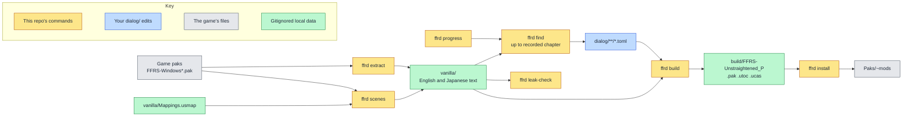

<!--
SPDX-FileCopyrightText: Copyright (c) 2026 Josh Symonds
SPDX-License-Identifier: Apache-2.0
-->

# ffr-unstraightened

A text-only dialogue mod for FINAL FANTASY RESONANCE (Steam app 3259780, Unreal Engine).
It changes the game's English text. The default pak also carries an
`FFRS/Config/UserGame.ini` that adds its own localization folder. The `ffrd` command
line tool pulls the game's text, checks your edits against it, and packs them into
mod files the game loads.

## Why it exists

The game's text lives in `FFRS/Content/Localization/Game/<lang>/Game.locres` inside
the game's paks. Editing a line by hand breaks silently when the game changes that
line. Each edit here is keyed by namespace and key, and stores a hash of the line it
replaces. A build fails when that line changes in the game, so an update never
reverts an edit without warning.

## How it fits together

The colours show where each step runs. Yellow boxes are commands in this
repository. Blue is your `dialog/` edits. Grey is the game's files. Green is local
data that git ignores.



`ffrd extract` copies the game's text into `vanilla/`. `ffrd find` prints entries from
`vanilla/` as TOML stubs for you to edit. `ffrd build` checks `dialog/` against
`vanilla/` and writes the mod files to `build/`. `ffrd install` copies them into the
game. `ffrd leak-check` checks the git history for game text. `ffrd scenes` writes
`vanilla/scenes.json`, which lists the story lines with their speakers and voice cues.

## Install

You need Nix with devenv, and the game installed through Steam.

Run `direnv allow` to load the devenv environment through `.envrc`, or run `devenv shell`.
devenv provides repak with Epic's Oodle runtime, the .NET 10 SDK, Python with pylocres, ruff,
basedpyright, just, mermaid-cli, and the `ffrd` script. `ffrd` always runs from the
repository root.

## Use

Set the game's Text Language to English before you play.

| Command | What it does |
| --- | --- |
| `ffrd extract` | Unpacks the English and Japanese `Game.locres` from the installed game's paks into `vanilla/`, later patch paks winning. Writes `vanilla/BUILDID` and a reference `vanilla/en.po`. Run it after install and after every game update. |
| `ffrd progress <chapter>` | Records the chapter you are on. `ffrd progress` with no argument prints the recorded chapter. |
| `ffrd find [pattern] [-n NS]` | Prints vanilla entries as TOML stubs for `dialog/`. `pattern` is a case-insensitive regex matched against text or key. `-n` is a regex the namespace must match. Requires recorded progress. Prints `# N shown, M withheld` to stderr. |
| `ffrd build [--full \| --partial \| --ue4ss]` | Checks every `dialog/**/*.toml` edit against the game's text, then writes the mod to `build/`. The default shape packs the edited entries and a `UserGame.ini` that puts them ahead of the game's table. See [Build shapes](#build-shapes). |
| `ffrd install [--deck]` | Copies `build/FFRS-Unstraightened_P.pak`, `.utoc` and `.ucas` into `<game>/FFRS/Content/Paks/~mods`, whichever pak shape the last build wrote. It does not copy the `--ue4ss` folder. `--deck` copies them to a Steam Deck over `ssh`. |
| `ffrd uninstall [--deck]` | Removes the mod files from `Paks/~mods`. `--deck` removes them from a Steam Deck over `ssh`. |
| `ffrd leak-check` | Scans every commit reachable from HEAD for vanilla strings of 20 or more characters, in paths, file contents and messages. Prints `0` when clean. Otherwise prints a location and table key for each match, never the text, and exits 1. |
| `ffrd report --lens <name>` | Counts the outcomes in `work/<name>/outcomes.jsonl` per chapter: changed, kept for plot, gate failed, unfinished and untouched. Also counts changed lines per lens reason id and per numbered character, and gate failures per gate. Characters are numbers, never names. Lines without a chapter count under `unattributed`. After the blocks it prints `arcs: N, M with changes` from `work/<name>/arcs.json` and one `recall <id>: N disagreements, M confirmed` line per triage id from `recall.json`. Never prints line text. |
| `ffrd diff --lens <name>` | Shows each rewrite in `dialog/<name>/` beside its vanilla English line, for chapters at or below the recorded chapter. Lines from later chapters and lines without a chapter are hidden. Requires recorded progress. Prints `# N shown, M withheld, K without a chapter` to stderr. |
| `ffrd run --lens <name> [--no-jev]` | Rewrites the in-scope lines of the lens's scenes. Screens every scene, then runs the Jev recall check unless `--no-jev` skips it. Writes `work/<name>/outcomes.jsonl`, `arcs.json` and `recall.json`, and each changed line to `dialog/<name>/`. See [Rewrite pipeline](#rewrite-pipeline). |
| `ffrd smoke [--scene <key>]` | Runs one in-scope scene through every stage of `ffrd run` with live models, writing only under `work/smoke/`. Prints a count per stage and exits 1 when a stage produced no result. See [Smoke run](#smoke-run). |
| `ffrd probe [--shape {target,full,partial,ue4ss}]` | Checks which text shape the game honours, by running the game on the probe host. Without `--shape`, it tries `target`, then `full`. `--shape` probes one shape alone. Prints only keys and hashes. See [Probe host](#probe-host). |
| `ffrd usmap` | Dumps the game's mappings on the probe host to `vanilla/Mappings.usmap`. Re-run it after each game update. See [Probe host](#probe-host). |
| `ffrd scenes [--check]` | Runs the C# extractor in `tools/scenes/` through `dotnet run` and writes `vanilla/scenes.json`. Needs `ffrd extract` and `ffrd usmap` for the same game build. Prints counts only. `--check` prints the counts and the attributed percentage, and exits 1 when the table is missing, built for another game build, or under 95% attributed. See [Scene data](#scene-data). |

Edits go in any `dialog/**/*.toml` file. Each edit is one table, keyed by namespace
and key, with `vanilla` (the hash of the current English line) and `text` (your
replacement). The format and the rules `ffrd build` enforces are in
[dialog/README.md](dialog/README.md). A stub from `ffrd find` starts with `text` set
to the game's line; `ffrd build` rejects it until you change `text`.

### Build shapes

`ffrd build` has four shapes. The default is `target`. Each pak shape writes
`build/FFRS-Unstraightened_P.pak`, `.utoc` and `.ucas`. The `.utoc` and `.ucas` files
are copies of the game's empty `global` container, which the loader requires.

- `target` (default): the pak holds `FFRS/Content/Localization/Unstraightened/en/Unstraightened.locres`,
  which has only the edited entries, and `FFRS/Config/UserGame.ini`. That ini lists the
  Unstraightened folder ahead of `Game`, so the game reads the edits first.
- `--full`: the pak holds `FFRS/Content/Localization/Game/en/Game.locres`, the whole
  English table with the edits applied. It replaces the game's own table.
- `--partial`: the pak holds `FFRS/Content/Localization/Game/en/Unstraightened.locres`,
  which has only the edited entries. The game was seen to ignore it. It is kept for
  comparison. See [Limits](#limits).
- `--ue4ss`: no pak. `build/UnstraightenedText/` holds `Scripts/main.lua`, an empty
  `enabled.txt` and `edits.txt`. It needs UE4SS on the player's install, and
  `ffrd install` does not copy it. The edits register only in English culture (`en`, `en-*`).

`ffrd find` only shows lines from chapters at or below the chapter you recorded.
Namespaces that name no chapter are never shown. A namespace names a chapter when it
has `ST_C<n>_` at the start or a later `C<n>` underscore segment.

To recover a Steam Deck install that breaks the game, run `ffrd uninstall --deck`.

### Rewrite pipeline

`ffrd run --lens <name>` changes only in-scope lines.
A line is in scope when the scene source yields it from the game's scene table. That
covers event dialogue, including unnumbered side events, which count under the chapter
that unlocks them, and the `ST_DialogChoice`, `ST_MainSummary` and `ST_UnitDescription`
namespaces. The bound source always has a scene table. A source without one, such as a
test fixture, uses a fallback allowlist. It matches the `ST_C<n>_`,
`ST_SubEv`, `ST_ChrEv`, `ST_FEV`, `ST_LegendEV`, `ST_GimEv`, `ST_BtlEv` and `ST_EV`
prefixes, plus the same three namespaces. Hard exclusions apply in every case:
`ST_Tutorial*`, `ST_UI*`, any namespace ending in `Name` or `SkillDescription`, and
`ST_ConsumablesDescription`, `ST_EquipmentDescription` and `ST_ArtifactDescription`.
Names, menus, items, skills and tutorials never change.

`ffrd run` works in three stages.

First, Opus writes a story bible for each chapter, in script order. A bible lists the
characters with their gender and notes, the facts, the callbacks, and the arcs. Each
arc has an id, its characters, its state in that chapter, and beats. A beat sits on a
line and has a kind (setup, escalation, declaration, payoff or other) and an earned
flag. Lines that name no chapter are read after the last chapter, one chunk per
namespace. Then a backward pass runs over the chapters in reverse order. It adds the
setups that later bibles rely on to each chapter's callbacks.

Second, the scenes run in order. Sonnet screens every line of the scene against
the screen criteria, with the cast notes from the bibles. Jev scores the scene for each
triage question. For each triage id that scores 0.5 or more and that the screen flagged
on no line, Opus rechecks the scene for that id, and the lines it flags join the screen's
flags. Opus then writes an intent for each flagged line, and one draft call writes the
drafts for all the flagged lines in the scene. Each draft is also rendered in the voice.
A line with no speaker is not voiced, so its voiced version is its draft unchanged.
Both versions go through the gates in this order: placeholders, tags, length (within
120% of vanilla, with the same line breaks), the classifier, and the scene judge. The
classifier fails a candidate that scores below 0.5, the bar the voice evaluation uses. The
scene judge checks meaning, plot, minimal change, callback and fixed. A line with
callbacks also goes to the cross-scene judge, which runs only after the scene judge
passes. If no candidate passes, the line gets one more draft, told which gate failed.
If that also fails, the line stays vanilla. It counts as kept for plot when the plot gate
failed, and as gate failed otherwise. Among the passing candidates, the one that restores
the Japanese meaning ranks first, then the one with the smallest edit distance from the
English line. A scene with two or more changed lines then goes through the coherence
check. It reads the scene with its rewrites applied, against the arcs and the judge
rubric.

Third, after all scenes, the arc judge reads each arc that has a changed line, its lines
in story order, with the rewrites applied. Each check works the same way. Opus names the
lines it would revert. If it finds a problem, a recheck sees those proposals and names
only the ones that must revert. A line reverts only when both passes name it.

Each changed line goes to `dialog/<name>/chapter-NN.toml`, or to
`dialog/<name>/unattributed.toml` when it names no chapter. Each table records the vanilla
hash, the text, the lens, the reason (the list of triage ids that flagged the line, in
lens order), the writer (`opus` or `voice`), the verdict and the run. The run also writes
`work/<name>/outcomes.jsonl` with one record per line, `arcs.json` with the arc count and
how many arcs have a change, and `recall.json` with, for each triage id, how many scenes
Jev disagreed with the screen on and how many of those the recheck confirmed. With
`--no-jev`, Jev is never called and every recall count is zero.

Progress prints scene keys and counts only. Every model result is saved under
`work/<name>/` as it arrives, so a rerun resumes where it stopped. Claude calls run
through `cswap`, which picks the least-used account. `ffrd run` needs `TYPESAFE_API_KEY`
unless `--no-jev` is given.

### Smoke run

`ffrd smoke` runs one scene through every stage of `ffrd run`, with live models. It
picks the first in-scope scene that has at least two lines with a speaker. `ffrd smoke
--scene <key>` picks the in-scope scene with that key, and fails when no in-scope scene
has it.

It needs the scene table from `ffrd scenes`, `TYPESAFE_API_KEY` (Jev is always on in
smoke), `cswap`, and `ffrd voice serve` running on the GPU host. The classifier and the
renderer reach that host over `ssh` on first use. The renderer runs through the
llama-server that `ffrd voice serve` started there.

Smoke writes only under `work/smoke/`. Its lens is built into `ffrd/pipeline/smoke.py`,
so its rewrites go to `work/smoke/dialog/smoke/` and never reach `dialog/`. The story
bibles are built from the chosen scene's lines alone.

Smoke first prints one count per fallback family, then one count for the lines in
scope only through the scene table, and one for the hard-excluded lines. Counts only:

```
prefix ST_C<n>_: 412
prefix ST_SubEv: 38
prefix ST_ChrEv: 0
prefix ST_FEV: 7
prefix ST_LegendEV: 0
prefix ST_GimEv: 15
prefix ST_BtlEv: 3
prefix ST_EV: 22
prefix ST_DialogChoice: 9
prefix ST_MainSummary: 4
prefix ST_UnitDescription: 11
prefix outside fallback: 130
prefix hard excluded: 96
```

`run` then prints its progress, with scene keys and counts only. Last, smoke prints one
line per required stage with its result count:

```
stage bible: 1
stage bible_setups: 1
stage screen: 1
stage triage: 1
stage rescreen: 1 (exercised)
stage intent: 2
stage draft: 1
stage render: 2
stage classifier: 4
stage judge: 3
stage cross_judge: 3
stage scene_coherence: 1 (exercised)
stage arc_judge: 1
stage selection: 9
```

Some stages depend on model answers that no lens can force: `rescreen`, `classifier`,
`judge`, `cross_judge`, `scene_coherence` and `arc_judge`. When `run` leaves one of them
without a result, smoke calls it once on the chosen scene, from the inputs `run`
recorded. It stores that result under `work/smoke/` and changes no outcome. Its stage
line then says `(exercised)`. The screen, intent, draft and render stages run as usual,
because smoke's lens makes the screen flag the first two spoken lines.

Smoke exits 0 only when every stage above has a result. A scene whose lines all stay
vanilla still passes, because `selection` counts a result when every line has an outcome
and none is unfinished. When a stage has no result, smoke still prints every stage line,
then fails with `ffrd: smoke: no result from <stage>, ...` and exits 1.

### Scene data

`ffrd scenes` needs `ffrd extract`, for `vanilla/BUILDID` and the English text, and
`ffrd usmap`, for `vanilla/Mappings.usmap`. Both must come from the same game build.
The first run restores NuGet packages over the network. The command writes
`vanilla/scenes.json` and prints counts only.

Each line record in `vanilla/scenes.json` has a scene id (the line table's package
path), the order within the scene, the namespace, the key, the speaker, and a voice
cue `{sheet, index}` or `null`. The speaker is the event data's speaker id, or `null`
when the line is unattributed. It is never guessed. Story lines are the keyed lines of
the line tables that event data references, and that have English text. A cue is set
only when exactly one cue name in the referencing event's cue sheet contains the line's
key. `ffrd.scenes.load()` returns the records as `SceneLine` and `Voice` dataclasses.

`ffrd scenes --check` prints story lines, scenes, attributed, unattributed, with cue,
and the attributed percentage. It exits 1 when the table is missing, when its build
differs from `vanilla/BUILDID`, or when less than 95% of lines are attributed.

### Environment variables

| Variable | Default | Purpose |
| --- | --- | --- |
| `FFR_GAME` | `~/.local/share/Steam/steamapps/common/FINAL FANTASY RESONANCE` | The installed game. |
| `FFR_VANILLA` | `<repo>/vanilla` | Where extracted vanilla text is read from and written to. |
| `FFR_PROGRESS` | `$XDG_STATE_HOME/ffrd/progress`, else `~/.local/state/ffrd/progress` | The file holding the recorded chapter. |
| `FFR_DECK_HOST` | `deck` | The `ssh` host for `--deck`. |
| `FFR_DECK_PAKS` | `~/.local/share/Steam/steamapps/common/FINAL FANTASY RESONANCE/FFRS/Content/Paks` | The Steam Deck's game Paks folder for `--deck`. |
| `TYPESAFE_API_KEY` | none | The Jev API key. `ffrd run` requires it unless `--no-jev` is given. `ffrd smoke` always requires it. |
| `TYPESAFE_BASE_URL` | `https://api.typesafe.ai` | The Jev endpoint. |
| `TYPESAFE_MODEL` | `jev-latest` | The Jev model. |
| `FFR_PROBE_HOST` | `gnomon` | The `ssh` host for `ffrd probe` and `ffrd usmap`. |
| `FFR_PROBE_GAME` | `~/.local/share/Steam/steamapps/common/FINAL FANTASY RESONANCE` | The installed game on the probe host. |
| `FFR_OODLE` | Set by devenv | The Oodle library the `ffrd scenes` extractor loads. |

`ffrd probe` and `ffrd usmap` also use `FFR_DECK_HOST` for the Deck check.

### Probe host

`ffrd probe` and `ffrd usmap` run the game on a Steam machine that `ssh` reaches, the
probe host. They use UE4SS, a Lua mod loader for Unreal Engine games. The probe host needs:

- Steam running, with FFR installed.
- UE4SS 3.0.1 experimental (tested as build 1195), installed as
  `FFRS/Binaries/Win64/dwmapi.dll` and `FFRS/Binaries/Win64/ue4ss/`. Disable UE4SS's
  bundled mods. In `UE4SS-settings.ini`, set `MajorVersion = 5` and `MinorVersion = 6`.
- `dwmapi` set to `native,builtin` in the game's Proton prefix, or
  `WINEDLLOVERRIDES="dwmapi=n,b"` in the Steam launch options.
- If the session sets `d3dcompiler_47=n`, UE4SS hangs at start. Allow the builtin
  fallback for this game, for example with a protonfixes local fix for app 3259780.
- With no monitor connected, the game hangs at start under Proton's native Wayland
  driver, which is the host-wide default (`PROTON_USE_WAYLAND=1`). Probe launches need
  the X11 driver. The same protonfixes local fix for app 3259780 switches launches that
  pass `-RenderOffscreen` to X11. Only probe launches pass that flag, so the player's own
  launches keep their driver.
- Nothing else in the game folder changes.

Both commands refuse while FFR runs on the Steam Deck named by `FFR_DECK_HOST`. If the
Deck cannot be reached, they print a note and go on.

`ffrd probe` checks which shape the game honours. Without `--shape`, it tries `target`
first, and `full` only when `target` is not honoured. `--shape` probes one of
`target`, `full`, `partial` or `ue4ss` alone. For each pak shape, it packs one edited
line of `ST_UI_TitleMenu,UI_Title_Copyright`, installs the pak in the probe host's
`Paks/~mods` with `.utoc` and `.ucas` copied from its `global` container, and launches
the game. The `ue4ss` shape installs no pak. It runs the same probe mod beside the
repo's text mod `ue4ss/UnstraightenedText`, whose `edits.txt` holds the one probe edit.
The UE4SS mod `ue4ss/UnstraightenedProbe` reads that key's hash from the running game.
Then the command quits the game and removes the paks and the mods. It exits 0 and names
the honoured shape, for example `shape honoured: full`. It exits 1 when no shape it
tried is honoured. When a launch's log holds no observation for the probe key, the run
is inconclusive: it exits 1 saying the game produced no observation, and tries no
further shape. It refuses while FFR runs on the probe host, and when the probe
host's game build differs from `vanilla/BUILDID`.

`ffrd usmap` runs `ue4ss/UnstraightenedUsmap` on the probe host to dump the game's
mappings. It saves them to `vanilla/Mappings.usmap`, which git ignores. Re-run it after
each game update.

Each launch runs `steam -applaunch 3259780 -RenderOffscreen` on the probe host.
`-RenderOffscreen` keeps the game ticking while its window is unfocused. A launch that
stalls at start is killed and relaunched, up to 4 launches in all.

The latest probe runs found the target, full and ue4ss shapes honoured, and the partial
shape not honoured. A plugin localization target, which is not a build shape, was not
honoured. The ue4ss shape honours edits in English culture only. Run `ffrd probe` again
after a game update to re-check.

## Limits

- **`ffrd smoke` needs `ffrd voice serve` running on the GPU host.** Its render stage
  fails without a running llama-server.
- **`--partial` does not work for edited entries.** `ffrd build --partial` writes
  `en/Unstraightened.locres`, which holds only the edited entries. The game was seen to
  ignore a second `en/*.locres` for an entry `Game.locres` already holds, so the edits
  have no effect. The default `target` shape uses its own folder, listed ahead of
  `Game`, and the latest probe run honoured it. `--full` replaces `Game.locres` with the
  whole English table and the edits applied, which the game was seen to honour. Run
  `ffrd probe` to re-check this.
- **Game updates block builds.** `ffrd build` refuses to run when the game has
  updated since `ffrd extract`. The error says to run `ffrd extract` and rebuild.
- **Edits fail on changed lines.** An edit whose `vanilla` hash no longer matches the
  game's current line fails the build with "changed in the game".
- **`ffrd leak-check` skips short strings.** It ignores vanilla strings shorter than
  20 characters, so a short match is not reported.
- **Text only.** The mod changes the game's English text. The default pak also carries
  an `FFRS/Config/UserGame.ini` that adds its localization folder. It does not change
  assets, and it does not change Japanese text.

## Development

- `just check` runs ruff lint and format checks, basedpyright, and pytest.
- `just fmt` formats and fixes with ruff.
- `just docs` renders every Mermaid block in tracked Markdown to SVG under `build/docs/`.
- `just check-provenance` fails when the history names withheld private terms. It
  prints locations and digest prefixes, never the matched text.

Tests use synthetic fixtures only. See `tests/conftest.py`. Coding agents follow
[AGENTS.md](AGENTS.md).

`vanilla/`, `work/` and `build/` are gitignored.

## License

The code is licensed under the Apache License 2.0. See [LICENSE](LICENSE).

FINAL FANTASY RESONANCE and its text belong to Square Enix. The edits in `dialog/`
derive from Square Enix's text. This repository claims no license over them.
