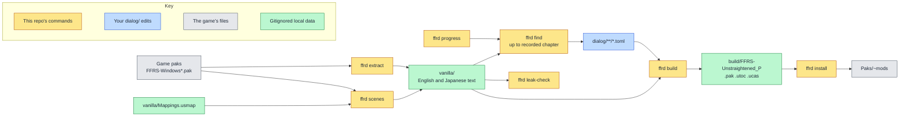

<!--
SPDX-FileCopyrightText: Copyright (c) 2026 Josh Symonds
SPDX-License-Identifier: Apache-2.0
-->

# ffr-unstraightened

A text-only dialogue mod for FINAL FANTASY RESONANCE (Steam app 3259780, Unreal Engine).
It changes the game's English string table and nothing else. The `ffrd` command
line tool pulls the game's text, checks your edits against it, and packs them into
mod files the game loads.

## Why it exists

The game's text lives in `FFRS/Content/Localization/Game/<lang>/Game.locres` inside
the game's paks. Editing a line by hand breaks silently when the game changes that
line. Each edit here is keyed by namespace and key, and stores a hash of the line it
replaces. A build fails when that line changes in the game, so an update never
reverts an edit without warning.

## How it fits together

The colours show where each step runs. Yellow boxes are commands in this
repository. Blue is your `dialog/` edits. Grey is the game's files. Green is local
data that git ignores.

`ffrd extract` copies the game's text into `vanilla/`. `ffrd find` prints entries from
`vanilla/` as TOML stubs for you to edit. `ffrd build` checks `dialog/` against
`vanilla/` and writes the mod files to `build/`. `ffrd install` copies them into the
game. `ffrd leak-check` checks the git history for game text. `ffrd scenes` writes
`vanilla/scenes.json`, which lists the story lines with their speakers and voice cues.

## Install

You need Nix with devenv, and the game installed through Steam.

Run `direnv allow` to load the devenv environment through `.envrc`, or run `devenv shell`.
devenv provides repak with Epic's Oodle runtime, the .NET 10 SDK, Python with pylocres, ruff,
basedpyright, just, mermaid-cli, and the `ffrd` script. `ffrd` always runs from the
repository root.

## Use

Set the game's Text Language to English before you play.

| Command | What it does |
| --- | --- |
| `ffrd extract` | Unpacks the English and Japanese `Game.locres` from the installed game's paks into `vanilla/`, later patch paks winning. Writes `vanilla/BUILDID` and a reference `vanilla/en.po`. Run it after install and after every game update. |
| `ffrd progress <chapter>` | Records the chapter you are on. `ffrd progress` with no argument prints the recorded chapter. |
| `ffrd find [pattern] [-n NS]` | Prints vanilla entries as TOML stubs for `dialog/`. `pattern` is a case-insensitive regex matched against text or key. `-n` is a regex the namespace must match. Requires recorded progress. Prints `# N shown, M withheld` to stderr. |
| `ffrd build [--partial]` | Checks every `dialog/**/*.toml` edit against the game's text, then writes the mod files to `build/`. By default it packs the whole English table with the edits applied. `--partial` packs only the edited entries, which the game was seen to ignore. |
| `ffrd install [--deck]` | Copies the three mod files into `<game>/FFRS/Content/Paks/~mods`. `--deck` copies them to a Steam Deck over `ssh`. |
| `ffrd uninstall [--deck]` | Removes the mod files from `Paks/~mods`. `--deck` removes them from a Steam Deck over `ssh`. |
| `ffrd leak-check` | Scans every commit reachable from HEAD for vanilla strings of 20 or more characters, in paths, file contents and messages. Prints `0` when clean. Otherwise prints a location and table key for each match, never the text, and exits 1. |
| `ffrd probe` | Checks which text shape the game honours, by running the game on the probe host. Prints only keys and hashes. See [Probe host](#probe-host). |
| `ffrd usmap` | Dumps the game's mappings on the probe host to `vanilla/Mappings.usmap`. Re-run it after each game update. See [Probe host](#probe-host). |
| `ffrd scenes [--check]` | Runs the C# extractor in `tools/scenes/` through `dotnet run` and writes `vanilla/scenes.json`. Needs `ffrd extract` and `ffrd usmap` for the same game build. Prints counts only. `--check` prints the counts and the attributed percentage, and exits 1 when the table is missing, built for another game build, or under 95% attributed. See [Scene data](#scene-data). |

Edits go in any `dialog/**/*.toml` file. Each edit is one table, keyed by namespace
and key, with `vanilla` (the hash of the current English line) and `text` (your
replacement). The format and the rules `ffrd build` enforces are in
[dialog/README.md](dialog/README.md). A stub from `ffrd find` starts with `text` set
to the game's line; `ffrd build` rejects it until you change `text`.

Each `ffrd build` writes `build/FFRS-Unstraightened_P.pak`, `.utoc` and `.ucas`.
The `.utoc` and `.ucas` files are copies of the game's empty `global` container,
which the loader requires.

The default build writes `en/Game.locres`, which holds the whole English table with the
edits applied. `ffrd build --partial` writes `en/Unstraightened.locres` instead, which
holds only the edited entries. See [Limits](#limits).

`ffrd find` only shows lines from chapters at or below the chapter you recorded.
Namespaces that name no chapter are never shown. A namespace names a chapter when it
has `ST_C<n>_` at the start or a later `C<n>` underscore segment.

To recover a Steam Deck install that breaks the game, run `ffrd uninstall --deck`.

### Scene data

`ffrd scenes` needs `ffrd extract`, for `vanilla/BUILDID` and the English text, and
`ffrd usmap`, for `vanilla/Mappings.usmap`. Both must come from the same game build.
The first run restores NuGet packages over the network. The command writes
`vanilla/scenes.json` and prints counts only.

Each line record in `vanilla/scenes.json` has a scene id (the line table's package
path), the order within the scene, the namespace, the key, the speaker, and a voice
cue `{sheet, index}` or `null`. The speaker is the event data's speaker id, or `null`
when the line is unattributed. It is never guessed. Story lines are the keyed lines of
the line tables that event data references, and that have English text. A cue is set
only when exactly one cue name in the referencing event's cue sheet contains the line's
key. `ffrd.scenes.load()` returns the records as `SceneLine` and `Voice` dataclasses.

`ffrd scenes --check` prints story lines, scenes, attributed, unattributed, with cue,
and the attributed percentage. It exits 1 when the table is missing, when its build
differs from `vanilla/BUILDID`, or when less than 95% of lines are attributed.

### Environment variables

| Variable | Default | Purpose |
| --- | --- | --- |
| `FFR_GAME` | `~/.local/share/Steam/steamapps/common/FINAL FANTASY RESONANCE` | The installed game. |
| `FFR_VANILLA` | `<repo>/vanilla` | Where extracted vanilla text is read from and written to. |
| `FFR_PROGRESS` | `$XDG_STATE_HOME/ffrd/progress`, else `~/.local/state/ffrd/progress` | The file holding the recorded chapter. |
| `FFR_DECK_HOST` | `deck` | The `ssh` host for `--deck`. |
| `FFR_DECK_PAKS` | `~/.local/share/Steam/steamapps/common/FINAL FANTASY RESONANCE/FFRS/Content/Paks` | The Steam Deck's game Paks folder for `--deck`. |
| `FFR_PROBE_HOST` | `gnomon` | The `ssh` host for `ffrd probe` and `ffrd usmap`. |
| `FFR_PROBE_GAME` | `~/.local/share/Steam/steamapps/common/FINAL FANTASY RESONANCE` | The installed game on the probe host. |
| `FFR_OODLE` | Set by devenv | The Oodle library the `ffrd scenes` extractor loads. |

`ffrd probe` and `ffrd usmap` also use `FFR_DECK_HOST` for the Deck check.

### Probe host

`ffrd probe` and `ffrd usmap` run the game on a Steam machine that `ssh` reaches, the
probe host. They use UE4SS, a Lua mod loader for Unreal Engine games. The probe host needs:

- Steam running, with FFR installed.
- UE4SS 3.0.1 experimental (tested as build 1195), installed as
  `FFRS/Binaries/Win64/dwmapi.dll` and `FFRS/Binaries/Win64/ue4ss/`. Disable UE4SS's
  bundled mods. In `UE4SS-settings.ini`, set `MajorVersion = 5` and `MinorVersion = 6`.
- `dwmapi` set to `native,builtin` in the game's Proton prefix, or
  `WINEDLLOVERRIDES="dwmapi=n,b"` in the Steam launch options.
- If the session sets `d3dcompiler_47=n`, UE4SS hangs at start. Allow the builtin
  fallback for this game, for example with a protonfixes local fix for app 3259780.
- Nothing else in the game folder changes.

Both commands refuse while FFR runs on the Steam Deck named by `FFR_DECK_HOST`. If the
Deck cannot be reached, they print a note and go on.

`ffrd probe` checks which shape the game honours. It tries the partial shape first, and
the full shape only when the partial one is not honoured. For each shape, it packs one
edited line of `ST_UI_TitleMenu,UI_Title_Copyright`, installs the pak in the probe host's
`Paks/~mods` with `.utoc` and `.ucas` copied from its `global` container, and launches
the game. The UE4SS mod `ue4ss/UnstraightenedProbe` reads that key's hash from the
running game. Then the
command quits the game and removes the paks and the mod. It exits 0 and names the honoured
shape, for example `shape honoured: full`. It refuses while FFR runs on the probe host, and
when the probe host's game build differs from `vanilla/BUILDID`.

`ffrd usmap` runs `ue4ss/UnstraightenedUsmap` on the probe host to dump the game's
mappings. It saves them to `vanilla/Mappings.usmap`, which git ignores. Re-run it after
each game update.

A launch that stalls at start is killed and relaunched, up to 4 launches in all.

The last `ffrd probe` run found the partial shape not honoured and the full shape
honoured. Run `ffrd probe` again after a game update to re-check.

## Limits

- **`--partial` does not work for edited entries.** `ffrd build --partial` writes
  `en/Unstraightened.locres`, which holds only the edited entries. The game was seen to
  ignore a second `en/*.locres` for an entry `Game.locres` already holds, so the edits
  have no effect. The default build replaces `Game.locres` with the whole English table
  and the edits applied, which the game was seen to honour. Run `ffrd probe` to re-check
  this.
- **Game updates block builds.** `ffrd build` refuses to run when the game has
  updated since `ffrd extract`. The error says to run `ffrd extract` and rebuild.
- **Edits fail on changed lines.** An edit whose `vanilla` hash no longer matches the
  game's current line fails the build with "changed in the game".
- **`ffrd leak-check` skips short strings.** It ignores vanilla strings shorter than
  20 characters, so a short match is not reported.
- **Text only.** The mod changes the English string table. It does not change
  assets, and it does not change Japanese text.

## Development

- `just check` runs ruff lint and format checks, basedpyright, and pytest.
- `just fmt` formats and fixes with ruff.
- `just docs` renders every Mermaid block in tracked Markdown to SVG under `build/docs/`.
- `just check-provenance` fails when the history names withheld private terms. It
  prints locations and digest prefixes, never the matched text.

Tests use synthetic fixtures only. See `tests/conftest.py`. Coding agents follow
[AGENTS.md](AGENTS.md).

`vanilla/` and `build/` are gitignored.

## License

The code is licensed under the Apache License 2.0. See [LICENSE](LICENSE).

FINAL FANTASY RESONANCE and its text belong to Square Enix. The edits in `dialog/`
derive from Square Enix's text. This repository claims no license over them.
